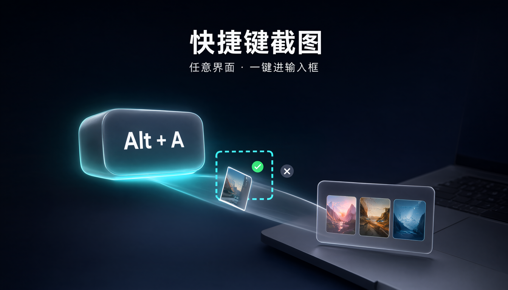
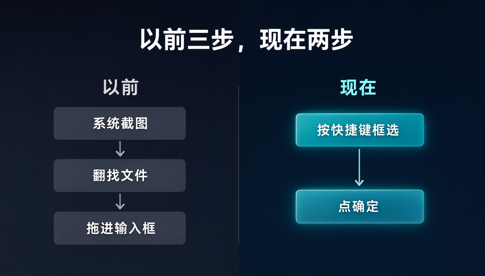
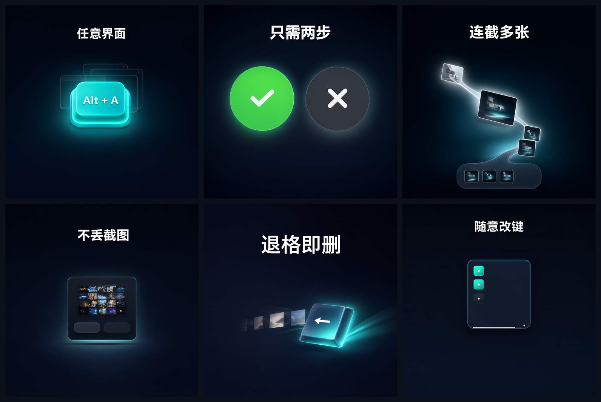
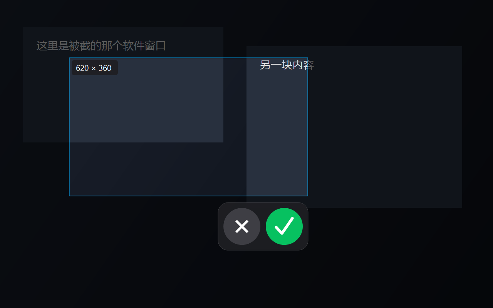
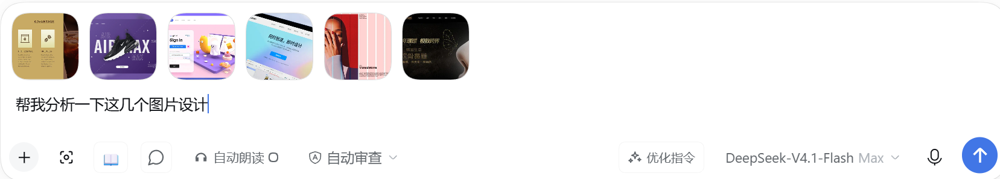
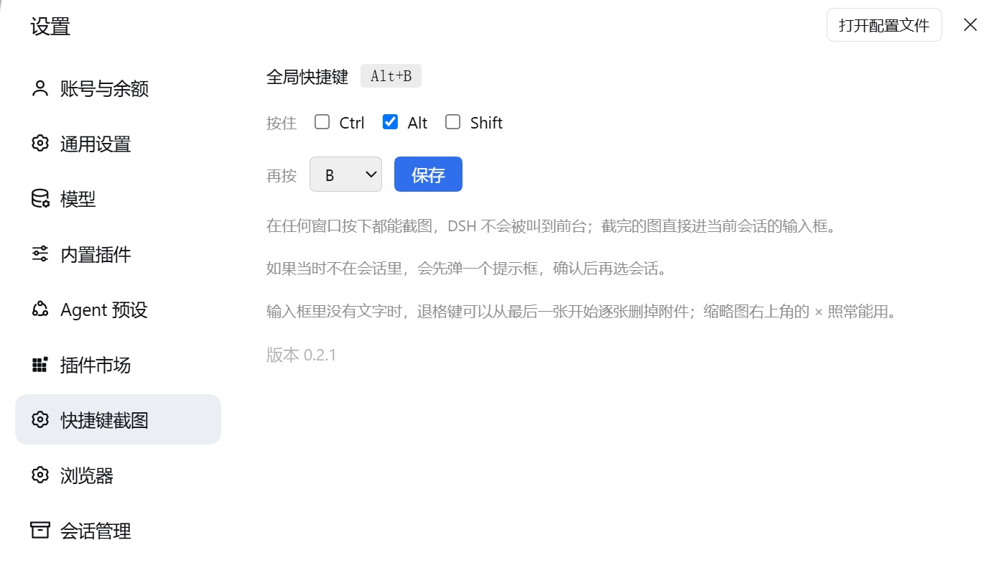

# dsh-quickshot · 快捷键截图

在**任意界面**按一下快捷键，框选一块屏幕，截图**直接进入 DSH 当前会话的输入框**——不用切回 DSH，不用找文件，不用拖拽。







---

## 三句话说完它好在哪

**一、哪儿都能截。**
你在浏览器、文档、聊天软件、远程桌面、任何窗口前面，按 `Alt+A` 就能框选。截完 DSH 不会跳出来抢你的画面，你还是停在刚才那个窗口。

**二、只有两个按钮。**
框选完，选区右下角只有绿色对钩（确定）和红叉（取消）。没有工具条、没有二级菜单，不用学。按回车等于确定，按 `Esc` 或点右键等于取消。

**三、可以一直截。**
截一张不满意？再按一次。截三张一起发？连按三次，三张会依次堆在同一个输入框里，最后打一段话一起发出去。DSH 单条消息最多挂 20 张图，在这个数量以内随便连。

## 实际长什么样

**框选的时候**：屏幕定格变暗，拖出选区后左上角显示尺寸，右下角只有两个按钮——绿勾确定、红叉取消。



**截完之后**：图直接躺在输入框里，可以继续截、继续打字，最后一起发。



**想换快捷键**：设置 → 快捷键截图，勾修饰键、选按键、保存，立即生效。



## 另外两个别人常丢掉的场景

**不在会话里也能截，而且不会白截。**
你当时如果停在插件页、设置页，或者根本没打开会话，截图不会丢：会弹一个系统提示框「请选择截图输入的会话」，点确定后 DSH 到前台，你切回任意一个会话，刚才的截图会自动放进那个会话的输入框；点取消这张图丢掉，DSH 也不会弹出来。

**输入框空的时候，退格键能逐张删图。**
连着截了五张发现只要最后一张？输入框里没有文字时按一下 `Backspace` 删最后一张，连按连删。右上角那个 `×` 照常能用。

## 快捷键可以改

设置 → 快捷键截图，勾选 Ctrl / Alt / Shift，再选字母、数字或 F1–F12，点保存立刻生效，不用重启。

如果你选的组合已经被别的软件占了（微信的截图默认也是 `Alt+A`），界面上会直接提示「这个组合被别的软件占用了，换一个试试」。

## 安装

从 npm 安装（推荐）：

```powershell
dsh plugin --profile desktop add dsh-quickshot
```

从 GitHub 安装：

```powershell
dsh plugin --profile desktop add https://github.com/zhaoqiminggg/dsh-quickshot
```

装完重启 DeepSeek Harness。首次使用会花几秒钟，用系统自带的 C# 编译器现场生成截图小程序，不需要另装任何运行库。

## 常见叫法

截图输入、快捷截图、任意界面截图、截图插件、全局截图、截图进输入框、框选截图、screenshot hotkey、region capture。

## 它是怎么工作的

插件由三部分组成，全部在本机运行：

| 部分 | 作用 |
|---|---|
| `native/quickshot.cs` | 原生小程序：常驻监听快捷键、全屏冻结框选、弹出选择会话的提示框。首次使用时编译到 DSH 数据目录，不放在插件目录里（Windows 不允许改写正在运行的程序）。 |
| `index.js` | 宿主半边：拉起上面那个小程序，提供取图接口，改快捷键时重启监听。 |
| `client.js` | 网页半边：把取到的图放进输入框，处理"不在会话里"的提示流程，以及退格删图。 |

## 隐私与安全

- 截图只在**本机**处理，不联网、不上传、无遥测。
- 不读取剪贴板，不记录键盘输入内容；退格删图只在输入框为空时生效，且只作用于输入框里已有的附件。
- 系统级快捷键由插件自带的小程序注册，DSH 退出时它自行退出，不留后台进程。
- 取图接口只接受带插件标记的请求，不是公开端口。

## 兼容性

- 仅 **Windows 10 / 11**（依赖 Win32 与 Windows 自带的 .NET Framework 4 C# 编译器）。
- 需要 DeepSeek Harness **0.2.x**（`>=0.2.0-rc.2 <0.3.0-0`）。
- 多显示器、高 DPI 已处理：整个虚拟桌面合成一张图。

## 已知限制

- 独占全屏的游戏、UAC 安全桌面等强制最上层画面可能截不到。
- DSH 单条消息最多 20 张图片，超过的部分会被拒绝（图不会丢，会留在排队里等下一次）。
- 框选界面的按钮尺寸是固定的，4K 屏上会显得偏小，后续会跟随系统缩放。
- 快捷键若与其他软件冲突，注册会失败，设置页会显示提示，换一个组合即可。

## 许可

MIT
